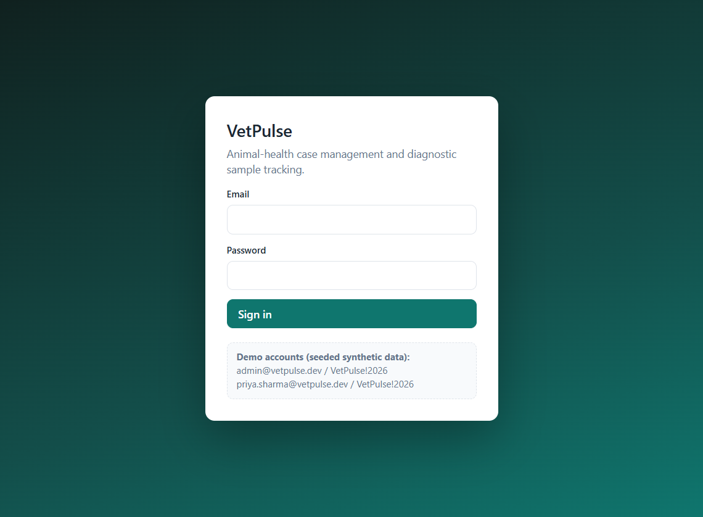
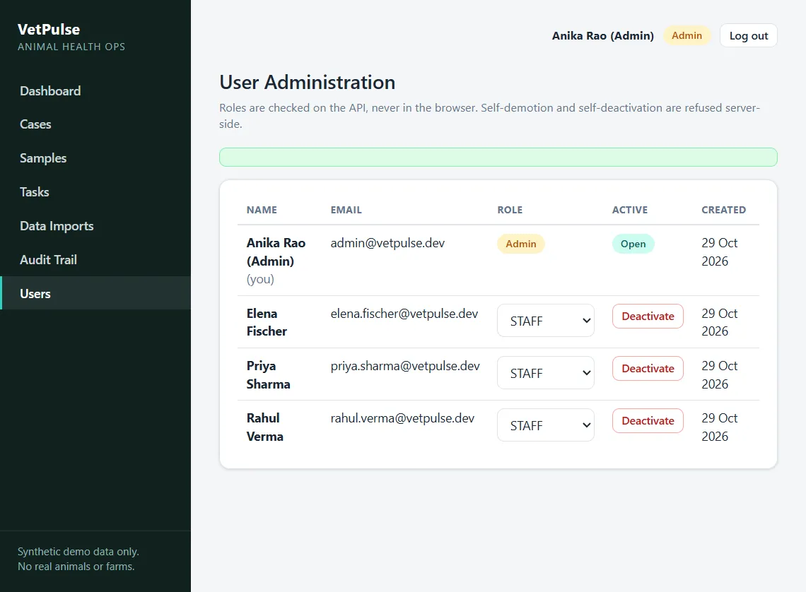

<div align="center">

# VetPulse

### Animal-health case management, diagnostic sample tracking, and data-quality dashboards.

[](https://react.dev)
[](https://www.typescriptlang.org)
[](https://expressjs.com)
[](https://www.postgresql.org)
[](https://www.prisma.io)
[](https://www.python.org)
[](LICENSE)
[](#synthetic-demo-data)

[](https://github.com/yakshini12/vetpulse-animal-health-platform)
[](#quick-start)

</div>

<p align="center">
  
  <br>
  <em>Sign in with seeded demo data to explore the case, sample, and audit workflows.</em>
</p>

**VetPulse** is a full-stack portfolio project built for the Zoetis Tech & Digital internship application (Yakshini Patila, Nov 2026). It brings animal-health cases, diagnostic samples, CSV imports, and data-quality signals into one workflow.

### Synthetic demo data

Every record is **synthetic**: pseudonymous owner codes (`ORG-117`), invented staff names, and fictional lab locations. No real animals, farms, people, or Zoetis branding are involved.

### Technology

[](https://react.dev)
[](https://vite.dev)
[](https://www.typescriptlang.org)
[](https://nodejs.org)
[](https://expressjs.com)
[](https://www.postgresql.org)
[](https://www.prisma.io)
[](https://www.python.org)
[](https://vitest.dev)
[](https://github.com/yakshini12/vetpulse-animal-health-platform/actions/workflows/ci.yml)

### Skills demonstrated

[](#architecture)
[](#architecture)
[](#what-it-does)
[](#what-it-does)
[](#architecture)
[](#testing)

| Layer | Technology |
| --- | --- |
| Frontend | React 19 + TypeScript + Vite + Recharts, plain CSS design tokens |
| Backend | Node 22 + TypeScript + Express 4 + Zod, modular monolith |
| Database | PostgreSQL 16 + Prisma ORM, versioned migrations |
| CSV validation | Python 3 micro-service (`vetpulse_csv`, stdlib only) |
| Tests | Vitest + Supertest (API, 63), Vitest + Testing Library (web, 17), unittest (Python, 18) |
| CI | GitHub Actions — lint, typecheck, tests, production build |
| Lint | oxlint + Prettier |

---

## What it does

### 1 — Animal case management
Cases (`CASE-2026-NNNN`, auto-numbered with race-safe generation) carry species, breed,
age, a pseudonymous owner organisation code and a free-text concern. Priorities
(LOW → CRITICAL) are ranked in the database so lists can sort by urgency.

| From | Allowed transitions |
| --- | --- |
| `OPEN` | `IN_PROGRESS`, `CLOSED` |
| `IN_PROGRESS` | `RESOLVED`, back to `OPEN`, `CLOSED` |
| `RESOLVED` | `CLOSED`, reopen to `IN_PROGRESS` |
| `CLOSED` | *terminal — a closed case is read-only everywhere* |

### 2 — Diagnostic sample tracking
Samples (`SP-2026-NNNN`) belong to a case and move through a documented lab pipeline:

```
RECEIVED → IN_PROCESS → IN_REVIEW → COMPLETED          (happy path)
                      ↘ REJECTED                      (from IN_PROCESS or IN_REVIEW; terminal)
```

Every transition stamps its own timestamp (`processingStartedAt`, `completedAt`,
`rejectedAt`); `COMPLETED` and `REJECTED` are terminal, a completed sample can never
be rejected, and a **released** result requires `COMPLETED` status plus a summary.
Metadata is locked once processing has started — only `RECEIVED`/`IN_PROCESS`
samples can be edited.

**Data-quality rules** (checked live by the dashboard KPI, defined once in
`apps/api/src/samples/routes.ts` and reused by the API filter):

1. `collectionDate` in the future
2. missing `receivedAt`
3. `COMPLETED` but `completedAt` missing
4. `REJECTED` but missing `rejectedAt` or `rejectionReason`
5. `RELEASED` result while not `COMPLETED`
6. `RELEASED` without a result summary

The seed data deliberately includes three violating samples so the
"Invalid sample metadata" KPI and its filter are demonstrable end-to-end.

### 3 — CSV data import (Python × Node contract)
Two-step, audited import. **Python owns row-level validation** (schema, formats,
enums, date parsing and chronology, intra-file duplicates) and never touches the
database. **Node owns database-level checks** (case must exist / sample code must
not exist) and the **transactional commit** — valid rows are inserted and the batch
status + audit event are written in one transaction, or everything rolls back and a
`COMMIT_FAILED` record is persisted outside the failed transaction.

```
POST /api/imports/preview        multipart "file" → PREVIEWED batch + row report
POST /api/imports/:id/commit     valid rows only → COMMITTED, atomic
GET  /api/imports                history; GET /api/imports/:id incl. stored report
```

The status machine is `PREVIEWED → COMMITTED` or `PREVIEWED/COMMIT_FAILED` —
a committed batch can never be committed twice, and an import with zero valid rows
is refused rather than silently inserting nothing.

### Supporting modules
- **Tasks** — TODO/IN_PROGRESS/DONE/CANCELLED with reopen (`DONE → TODO` only), terminal
  CANCELLED, `isOverdue` flags, case/sample/user links.
- **Audit trail** — append-only `AuditEvent` per mutation (created/updated/transition/
  result/import/user events), written *inside* the same transaction as the change,
  with optional JSON metadata. Browsable under `/audit` with meta inspection.
- **Dashboard** — all figures from live database aggregation (group-by, raw SQL for
  workload/turnaround), zero caching, zero invented numbers; 30-day case volume,
  sample pipeline, team workload, tasks due soon, recent activity.
- **Auth** — email/password (bcrypt-hashed, cost 10), JWT in an httpOnly cookie
  (8 h), `ADMIN` can manage users but cannot demote/deactivate themselves;
  identical error message for unknown email and wrong password.

## Architecture

The browser talks to one API contract. In development, Vite proxies `/api` to Express; in production, Express serves the built React app and API from one origin. The CSV workflow deliberately splits row validation from database checks and commits valid rows with their audit event in one transaction.

~~~mermaid
flowchart LR
    subgraph Browser[Browser]
        UI[React 19 SPA<br/>Vite · React Router · Recharts]
    end

    subgraph API[Node.js API · Express]
        Routes[REST routes<br/>auth · cases · samples · tasks<br/>imports · dashboard · audit · users]
        Auth[Auth middleware<br/>JWT cookie · role checks]
        CSV[CSV import coordinator]
        Audit[Audit service]
        ORM[Prisma ORM]
    end

    subgraph Validator[Python data service]
        RowCheck[CSV row validation<br/>schema · formats · dates · duplicates]
    end

    DB[(PostgreSQL 16)]
    CI[GitHub Actions<br/>lint · typecheck · tests · build]

    UI -->|JSON + httpOnly session cookie| Routes
    Routes --> Auth
    Auth --> CSV
    Auth --> ORM
    ORM <--> DB
    Routes --> Audit
    Audit --> ORM
    CSV -->|uploaded CSV| RowCheck
    RowCheck -->|validation report| CSV
    CSV -->|case and sample reference checks| ORM
    CSV -->|preview batch + audit| ORM
    CSV -->|atomic valid-row commit + batch status + audit| ORM
    CI -. validates .-> API
    CI -. validates .-> Validator
    CI -. builds .-> UI
~~~

See [docs/architecture.md](docs/architecture.md) for the component responsibilities, security boundaries, and CSV transaction flow.

---

## Screenshots

| | |
| --- | --- |
|  |  |

*More captures (dashboard, case/sample detail, import report) are added as the
desktop capture window is available — see `docs/screenshots/`.*

---

## Quick start

### Windows — the tested path

Prerequisites: **Node 22+**, **npm 11+**, **Python 3.12+** (no pip installs needed —
the validator is stdlib-only).

```powershell
# 1 — backend
cd apps/api
npm install
npm run db:up        # starts the embedded PostgreSQL (port 54329, writes apps/api/.env)
npm run db:migrate   # applies the versioned migrations
npm run db:seed      # deterministic synthetic data (4 users, 24 cases, 37 samples, 16 tasks)
npm run dev          # API on http://localhost:4000

# 2 — frontend (second terminal)
cd apps/web
npm install
npm run dev          # UI on http://localhost:5173 (proxies /api to :4000)
```

Production-style single origin (no CORS, no proxy):

```powershell
cd apps/web ; npm run build      # produces apps/web/dist
cd ../api ; npm run build
node dist/server.js              # serves the SPA and the API on http://localhost:4000
```

**Demo accounts** (password `VetPulse!2026` for both):

| Role  | Email                        |
| ----- | ---------------------------- |
| ADMIN | `admin@vetpulse.dev`         |
| STAFF | `priya.sharma@vetpulse.dev`  |

### Docker alternative

```bash
docker compose up --build   # postgres + API + served SPA on http://localhost:4000
```

`docker-compose.yml` also doubles as a plain postgres provider for local work:
`docker compose up -d db` exposes PostgreSQL on **localhost:5433**
(user `postgres`, password `postgres`) — point `DATABASE_URL`/`TEST_DATABASE_URL`
at it instead of using the embedded server.

> **Honesty note.** The development machine used to build VetPulse has no Docker
> or WSL2 available, so the image path is written and YAML-validated but was not
> executed locally. The local Windows flow above is the tested path.

### Demo the CSV import

`examples/csv/` contains three files matched against the seeded cases:

| File | Rows | Validates as |
| --- | --- | --- |
| `samples_valid.csv` | 8 | all valid → commit inserts 8 |
| `samples_invalid.csv` | 8 | all rejected with varied codes (REQUIRED, FORMAT, VALUE, DATE, …) |
| `samples_duplicate.csv` | 5 | 3 valid + 2 intra-file duplicates |

---

## Configuration

`apps/api/.env` (created by `npm run db:up`; see `apps/api/.env.example`):

| Variable            | Purpose                                                        |
| ------------------- | -------------------------------------------------------------- |
| `PORT`              | API port (default 4000)                                        |
| `DATABASE_URL`      | Dev database (embedded postgres on `127.0.0.1:54329`)          |
| `TEST_DATABASE_URL` | Integration-test database (`vetpulse_test` on the same server) |
| `JWT_SECRET`        | Signs session tokens — never commit a real value               |
| `CLIENT_ORIGIN`     | CORS origin for the dev web client                             |
| `PYTHON_BIN`        | Optional override of the validator executable (default `python`) |
| `DATA_SERVICE_DIR`  | Optional override of the validator service location            |

---

## API surface (all JSON, cookie-authenticated)

| Area | Endpoints |
| --- | --- |
| Auth | `POST /api/auth/login`, `POST /api/auth/logout`, `GET /api/auth/me` |
| Cases | `GET/POST /api/cases`, `GET/PATCH /api/cases/:id` |
| Samples | `GET/POST /api/samples`, `GET/PATCH /api/samples/:id`, `POST /api/samples/:id/transition`, `POST /api/samples/:id/result` |
| Tasks | `GET/POST /api/tasks`, `PATCH /api/tasks/:id` |
| Imports | `GET /api/imports`, `GET /api/imports/:id`, `POST /api/imports/preview`, `POST /api/imports/:id/commit` |
| Misc | `GET /api/dashboard/summary`, `GET /api/audit`, `GET /api/users` (admin), `PATCH /api/users/:id` (admin), `GET /api/health` |

Lists share one contract: `?search&sort&order&page&pageSize` plus typed filters,
returning `{ items, page, pageSize, total, totalPages }`.
Errors always use the same envelope:

```json
{ "error": { "code": "INVALID_TRANSITION", "message": "Cannot move a case from CLOSED to OPEN. Allowed: none.", "details": {} } }
```

Codes are stable strings (`INVALID_CREDENTIALS`, `INVALID_TRANSITION`, `RECORD_LOCKED`,
`UNKNOWN_CASE`, `SAMPLE_EXISTS`, `COMMIT_FAILED`-related `DATABASE_UNAVAILABLE`, …);
role checks are server-side only and the web client mirrors transition maps purely
to decide which buttons to render.

---

## Testing

```bash
# API — 63 integration tests across 9 files (auth, error contract, cases, samples,
# tasks, imports incl. live Python-validator round-trip, audit, users, dashboard)
cd apps/api
npm run db:up
npx vitest run        # uses TEST_DATABASE_URL, applies migrations automatically

# Web — 17 tests (client contract, transition mirrors, UI rules, formatting)
cd apps/web
npm test

# Python validator — 18 unittest tests
cd data-service
python -m unittest discover -s tests
```

Typecheck (`tsc --noEmit`) and lint (`oxlint`) in both apps, and the production
build are part of CI (`.github/workflows/ci.yml`): three jobs mirror these commands
exactly; the API job runs against a `postgres:16` service container with the same
migrations.

---

## Repository layout

```
vetpulse/
├─ apps/
│  ├─ api/               Express + Prisma backend (modular monolith)
│  │  ├─ prisma/         schema.prisma, versioned migrations, deterministic seed
│  │  ├─ scripts/        db.mjs (embedded postgres lifecycle), mint-token.mjs (screenshot helper)
│  │  └─ src/            auth/ cases/ samples/ tasks/ imports/ dashboard/ audit/ users/ errors/ middleware/
│  └─ web/               React SPA (pages, api client, auth context, shared UI)
├─ data-service/         Python CSV validator (vetpulse_csv) + unit tests
├─ examples/csv/         demo files for the import workflow
├─ docs/                 architecture, screenshots, build log
└─ .github/workflows/    CI
```

---

## Known limitations (stated plainly)

- **Local tooling is Windows-first.** The embedded-postgres lifecycle script
  (`apps/api/scripts/db.mjs`) targets Windows paths; outside Windows, use the
  `docker compose up -d db` postgres or any reachable PostgreSQL and set the
  two URL variables.
- **Docker/CI unexecuted.** As noted above — YAML validated, commands mirrored
  locally, but no local Docker daemon existed to run the image.
- **vitest runs single-fork in `apps/web`** because the build machine has very
  little free RAM (worker pools OOM there); the config is committed with a comment.
- **No browser E2E automation.** The UI was verified by a scripted walk-through
  (login, dashboard, case/sample transitions, invalid-transition refusal, full
  valid+invalid CSV import, user administration) rather than Playwright.
- **Seeding is local-dev only** in the Docker path (`tsx` is a devDependency).

---

## Documentation index

- `docs/build-log.md` — the honest phase-by-phase build log (files, commands, defects)
- `docs/architecture.md` — system diagram and component walkthrough
- `data-service/README.md` — the Python validator contract
- `apps/api/.env.example` — environment template (no secrets committed anywhere)
- `LICENSE` — MIT

## License

MIT — see `LICENSE`.
